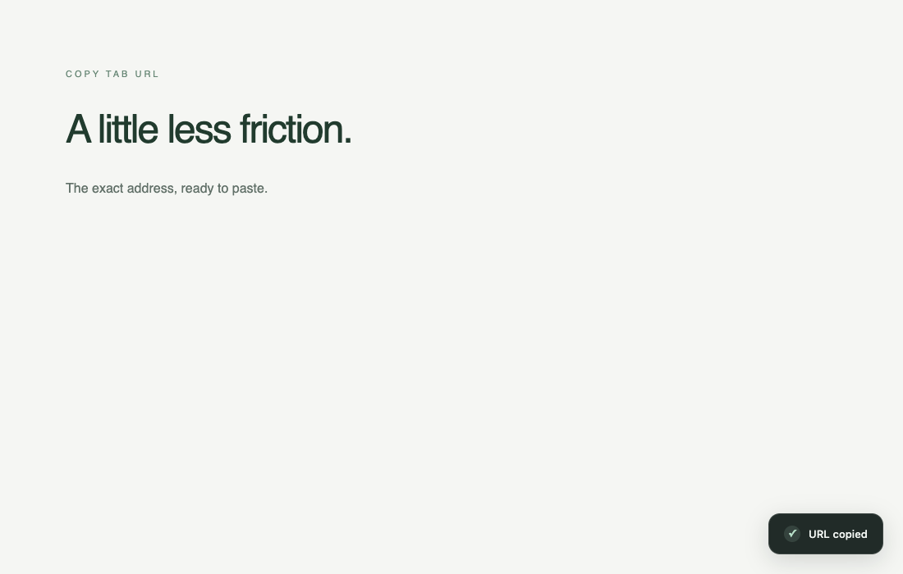

# Copy Tab URL

A tiny personal Manifest V3 Chrome extension. Copy the exact current tab URL, including its query and fragment, and get a quiet **URL copied** toast in the bottom-right corner.



## Install on either Mac

1. Download [copy-tab-url.zip](copy-tab-url.zip) and unzip it somewhere permanent.
2. Open `chrome://extensions` in Chrome and enable **Developer mode**.
3. Click **Load unpacked** and select the extracted **extension** folder (the one containing `manifest.json`). If downloading this repository instead, select `copy-tab-url/extension`.
4. Pin **Copy Tab URL** from Chrome's extensions menu for the toolbar fallback.
5. Open `chrome://extensions/shortcuts`. Find **Copy current tab URL**, click its pencil/Edit button, and press **Cmd+Shift+C**. Keep the scope **In Chrome**.
6. On an ordinary webpage, press the shortcut, then paste into a scratch note to confirm the full URL. The toolbar icon also copies on click.

**Shortcut caveat:** Chrome already uses Cmd+Shift+C for Inspect. In a clean Mac Chrome for Testing 153 profile, the manifest's suggested shortcut was unassigned. Explicitly assigning it in the shortcut editor registered `⇧⌘C` through `chrome.commands.getAll()`. Physical keyboard dispatch and the native Inspect conflict could not be verified in the headless environment. If it still opens Inspect or Chrome rejects it on your Mac, use another free shortcut, such as Cmd+Shift+Y if available, or the toolbar button. Chrome/OS-reserved shortcuts cannot be forced or bypassed. There is no page-level key interception or alternate automatic shortcut.

A work Mac may have enterprise policy that disables Developer mode or unpacked extensions. Ask your administrator if blocked; this extension cannot bypass policy. No Web Store installation is provided.

## Behavior and limits

- The URL comes directly from Chrome's tab object at invocation. No title, tracking removal, decoding, or URL normalization is applied.
- Copies only after the requested command or toolbar click. It never reads your clipboard.
- Clipboard success is checked before confirmation. Failure shows **Couldn’t copy URL** and a `!` toolbar badge.
- The toast uses a closed shadow root, a polite status announcement, reduced-motion support, and one instance whose 2.2-second timeout resets on repeated invocation.
- Repeated operations are serialized. Each invocation snapshots its original tab. If you switch tabs or navigate before completion, the extension avoids displaying the toast on a different URL; the result remains attached to the original tab's toolbar action.
- On `chrome://` pages, Web Store pages, PDFs, file URLs, and other restricted surfaces, a page toast may be unavailable. The toolbar's temporary checkmark/title provides confirmation when Chrome supplies the URL and permits clipboard writing. In the isolated browser test Chrome withheld the URL on `chrome://extensions/`, so it showed **Couldn’t copy URL** and preserved the previous clipboard. Other Chrome-internal and file pages may have the same limitation. File access is not requested.
- Toasts are only attempted on HTTP/HTTPS pages. Chrome's built-in PDF viewer and Web Store can still reject injection. A full-screen/top-layer page element may obscure an ordinary page toast.

## Permissions and privacy

Only `activeTab`, `scripting`, `clipboardWrite`, and `offscreen` are requested. `activeTab` grants temporary tab access after your command/click; `scripting` draws the toast; `clipboardWrite` and a short-lived offscreen document perform the copy independently of page restrictions. No `tabs`, clipboard-read, host permissions, `<all_urls>`, storage, network requests, analytics, external scripts, frameworks, or background monitoring.

The offscreen document uses checked `document.execCommand('copy')`, following Chrome's official sample because offscreen documents cannot be focused. It clears the textarea and closes after each operation. No copied URL is persisted.

## Verification

See [TESTING.md](TESTING.md) for observed results and their limits. The shipped extension requires no build and no npm installation. Test dependencies are development-only:

```sh
npm install
npx playwright install chromium
npm test
npm run test:browser
```

The browser test uses a new temporary profile, headless Chromium and a local HTTP fixture. It never opens your normal Chrome profile. Test clipboard data is synthetic.

## Official references

- [Commands and reserved shortcuts](https://developer.chrome.com/docs/extensions/reference/api/commands)
- [DevTools shortcuts](https://developer.chrome.com/docs/devtools/shortcuts)
- [activeTab and user gestures](https://developer.chrome.com/docs/extensions/develop/concepts/activeTab)
- [Scripting](https://developer.chrome.com/docs/extensions/reference/api/scripting)
- [Offscreen documents](https://developer.chrome.com/docs/extensions/reference/api/offscreen)
- [Clipboard permission](https://developer.chrome.com/docs/extensions/reference/permissions-list)
- [Chrome's offscreen clipboard example](https://github.com/GoogleChrome/chrome-extensions-samples/tree/main/functional-samples/cookbook.offscreen-clipboard-write)

Minimum Chrome version: 116. Personal unpacked distribution; no Web Store publication.
